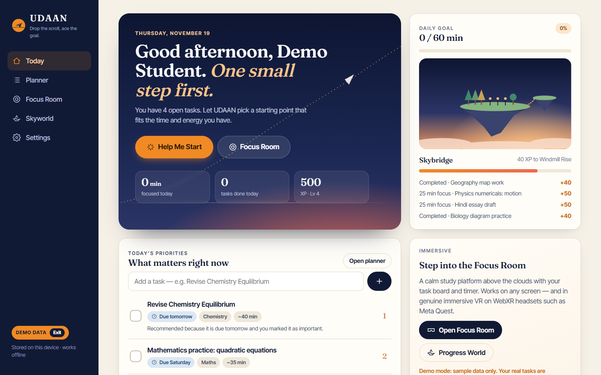
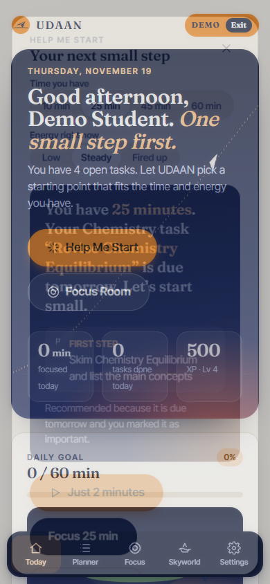
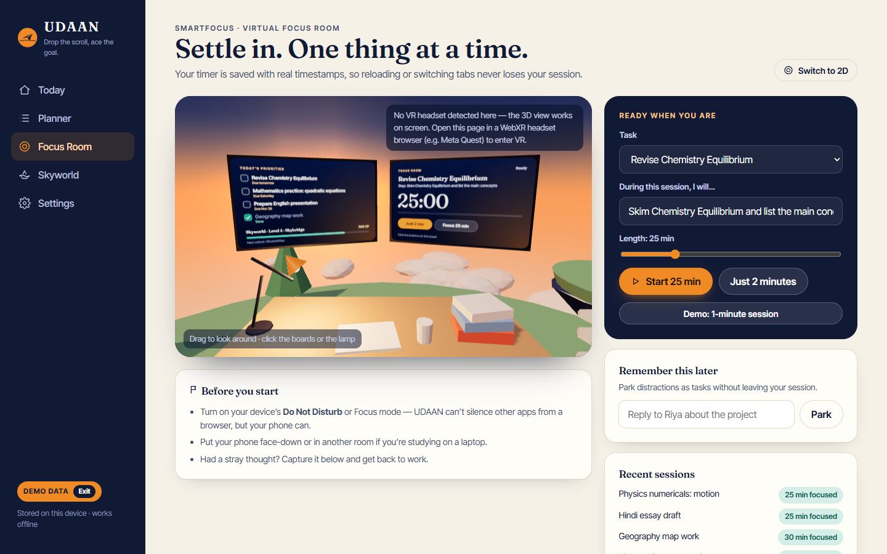
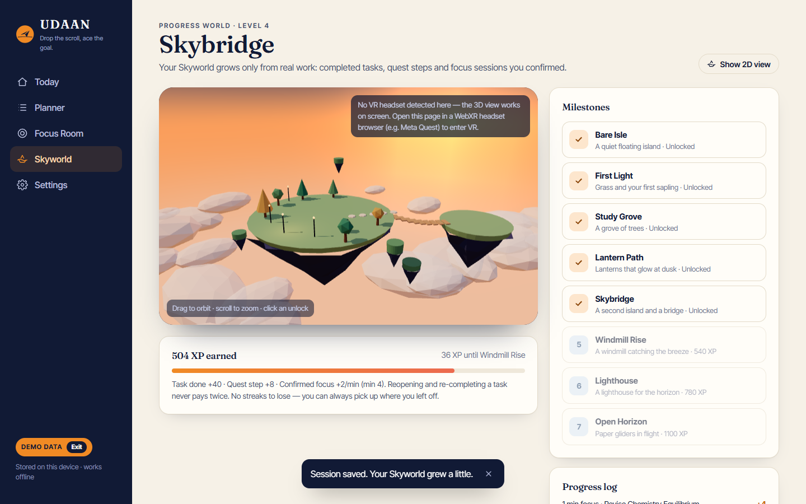

# PROJECT UDAAN

**Drop the scroll, ace the goal.** · *Break the Delay, Build the Day.*

UDAAN (Hindi: *flight*) is a calm, offline-first study companion for students who struggle to **start**. It turns a big assignment into one small first step, helps you focus on it, and grows a floating Skyworld from the real work you do — on a phone, a laptop, or inside a WebXR VR headset.

- **Live app:** https://aadit-issar.github.io/project-udaan/
- **Demo guide:** [DEMO_SCRIPT.md](DEMO_SCRIPT.md)

<p> </p>
<p> </p>

## What works

| Area | What it does |
| --- | --- |
| **Help Me Start** | Pick available time + energy → UDAAN recommends one task, its first concrete step, and *why* (deterministic, explainable scoring — no AI service, works offline). "Just 2 minutes" launches a tiny session. |
| **Priority Planner** | Add / edit / delete (with undo) tasks with subject, deadline, importance, estimate. Ranked by deadline, importance, effort and progress. Pin to override. |
| **Task Quest** | Template-based 5-step breakdowns (revision, practice, writing, presentation, project, exam). Steps are editable, re-orderable, removable; progress bar and XP per step. |
| **SmartFocus** | Timestamp-based timer (survives reloads/tab switches), pause/resume/finish/reset, intention, fullscreen zen view, distraction "park it" capture, wake lock, optional chime, honest "were you focused?" confirmation. |
| **Virtual Focus Room (3D)** | Procedural Three.js scene: study desk on a sky platform above a sea of clouds, clickable lamp, interactive task board + timer panels that read/write the same app state. Lazy-loaded. |
| **WebXR VR** | `navigator.xr.isSessionSupported('immersive-vr')` → **Enter VR** button → real `immersive-vr` session with `local-floor`, controller rays and `select` to press panel buttons (start/pause/finish timer, tick tasks). Hidden with an honest note when unsupported. |
| **AR board (optional)** | Where `immersive-ar` is supported, the task board can be placed on a surface via hit-test. |
| **Progress World** | 8 levels — grass, grove, lanterns, skybridge, windmill, lighthouse, gliders — earned only from completed tasks, steps and confirmed focus. XP is idempotent (re-completing never double-pays). 3D + 2D SVG fallback. |
| **Demo mode** | Separate sample data set ("Explore demo"); a "skip to end" control exists only in demo mode. Real data is never touched. |
| **Data** | localStorage only, export/import JSON backup (validated), clear data, PWA with offline service worker. |
| **Accessibility** | Keyboard reachable, labelled controls, reduced-motion & low-performance modes, 2D alternative for every 3D view. |

## Tech

React 19 + TypeScript + Vite · Three.js (WebXR via `renderer.xr`) · Vitest · GitHub Actions → GitHub Pages. No backend, no accounts, no analytics.

```bash
npm install
npm run dev      # local dev server
npm test         # domain unit tests
npm run build    # production build into dist/
```

## Testing status (honest)

- Unit tests: prioritisation, quest templates, timestamp timer, XP idempotency, import validation.
- `node scripts/smoke.mjs <url>` — Playwright walk-through (desktop 1440×900 + mobile 390×844) of onboarding → demo → Help Me Start → Task Quest → 3D Focus Room → demo session → Skyworld → Settings. Live site: **0 console errors, 0 failed requests**.
- `node scripts/xr-check.mjs <url>` — with a *mocked* `navigator.xr`, confirms the Enter VR button appears and calls `requestSession('immersive-vr', { optionalFeatures: ['local-floor','bounded-floor','hand-tracking'] })`, and that failures surface in the UI.
- **VR:** implemented against the standard WebXR Device API. *Not yet verified on physical headset hardware.* On desktops without a headset the Enter VR button is hidden and an explanation is shown. To test: open the live URL in the Meta Quest Browser → Focus Room → **Enter VR**.
- **AR:** optional; only offered when `immersive-ar` is reported supported (e.g. Chrome on ARCore Android). Not hardware-tested.

## Roadmap

Teacher/parent views, cloud sync, calendar import, spaced-repetition revision plans, multiplayer study rooms in VR, hand-tracking gestures, spatial audio soundscapes, richer Skyworld customisation, localisation (Hindi first).
